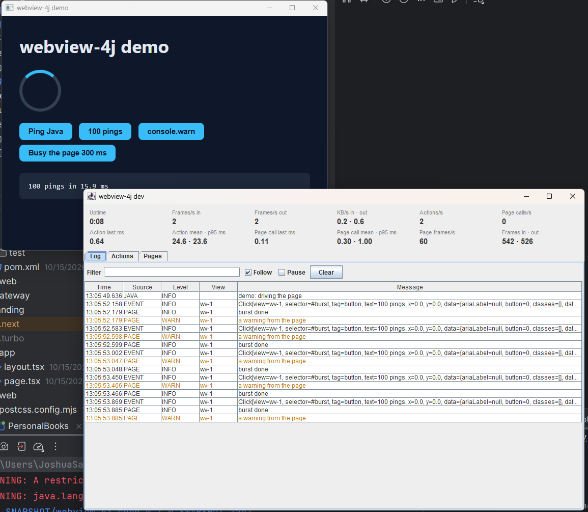

# webview-4j

A small Tauri-like desktop framework for Java: a native webview (WebView2 on Windows, WebKit on macOS and Linux)
driven from Java over FFM, with NATS-style messages as the frontend transport. No Electron, no bundled browser:
your UI is a web page, your logic is Java.

- **Java 25**, the Foreign Function & Memory API (no JNI), virtual threads for every callback
- **The native library is inside the jar** for Windows x64, Linux x64, macOS x64 and Apple silicon: add the dependency and run
- **Typed calls from the page**: `@WebViewController` classes become a TypeScript client at compile time (no reflection)
- **Devtools**: a window beside your app with its log and live metrics while you develop

## Add it

Gradle:

```kotlin
dependencies {
    implementation("io.joshuasalcedo:webview-4j-core:0.1.0")
    annotationProcessor("io.joshuasalcedo:webview-4j-processor:0.1.0")   // only for @WebViewController
    implementation("io.joshuasalcedo:webview-4j-devtools:0.1.0")          // optional
}
```

Maven:

```xml
<dependency>
    <groupId>io.joshuasalcedo</groupId>
    <artifactId>webview-4j-core</artifactId>
    <version>0.1.0</version>
</dependency>
```

Run with `--enable-native-access=ALL-UNNAMED` (or your module's name), as FFM asks.

## A window

```java
try (App app = App.start()) {
    View view = app.open(WindowOptions.url("https://example.com")).join();
    Object title = view.eval("document.title").join();
    app.whenStopped().join();   // until the user closes the app, or app.quit()
}
```

`WindowOptions.url(...)`, `WindowOptions.html(...)` or `WindowOptions.app("web")` (your built page, from the class
path) say what the window shows.

## Calls from the page

```java
@WebViewController("/users")
public class UserController {
    @Get("/{id}") public User find(@Path long id) { ... }
    @Post public CompletableFuture<User> create(@Body CreateUser body) { ... }
}

app.register(new UserController());
```

With the processor on the compile path, the page gets a typed client and calls `await users.find(42)`. For a
one-off: `app.handle("demo.ping", call -> Map.of("pong", 1))` in Java, `window.__webview4j.invoke("demo.ping", {...})`
in the page.

Events go the other way: `view.emit("topic", data)`. `app.subscribe(LogRecord.class, ...)` hears the page's console,
and its clicks, fetches and WebSockets when you turn them on (`view.capture(Capture.API, true)`).

## Devtools

```java
DevWindow.attachIfDev(app);   // with -Dwebview4j.dev=true or WEBVIEW4J_DEV=true
```



## Build it yourself

Needs Java 25 and Rust (cargo). On Linux also `libwebkit2gtk-4.1-dev libgtk-3-dev libasound2-dev`.

```shell
./gradlew build                 # the jar carries the native library for this machine
./gradlew :devtools:runDemo     # a sample app with the dev window
./gradlew publishToMavenLocal   # io.joshuasalcedo:webview-4j-* in ~/.m2
./gradlew prettyDocs            # the documentation site
```

How Java, the native side and the page talk: [PROTOCOL.md](PROTOCOL.md).

## Releases

Tag `vX.Y.Z` and push: the Release workflow (`.github/workflows/release.yml`) builds the native library on Windows,
Linux and macOS (x64 and Apple silicon), puts all of them in one jar, signs it and publishes every module to Maven
Central.

## Licence

[Apache License 2.0](LICENSE)
