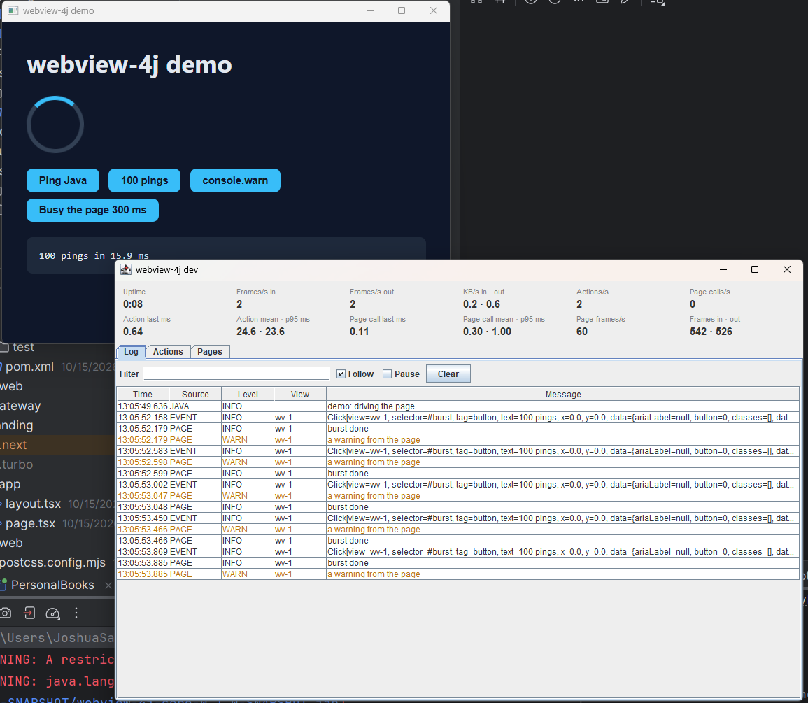

# webview-4j

[](https://central.sonatype.com/artifact/io.joshuasalcedo/webview-4j-core)
[](https://github.com/joshuasalcedo-dev/webview-4j/actions/workflows/ci.yml)
[](LICENSE)

A small Tauri-like desktop framework for Java: a native webview (WebView2 on Windows, WebKit on macOS and Linux)
driven from Java over FFM, with NATS-style messages as the frontend transport. No Electron, no bundled browser:
your UI is a web page, your logic is Java.

- **Java 25**, the Foreign Function & Memory API (no JNI), virtual threads for every callback
- **The native library is inside the jar** for Windows x64, Linux x64, macOS x64 and Apple silicon: add the dependency and run
- **Typed calls from the page**: `@WebViewController` classes become a TypeScript client at compile time (no reflection)
- **Native-looking components**: `@webview4j/ui`, React controls that look like Windows 11 or macOS, built into the
  jar for pages with no bundler, and on npm for apps with one
- **Devtools**: a window beside your app with its log and live metrics while you develop

## Three ways in

**1. Only Java.** Build the screens in Java from the native components: no HTML, CSS or JavaScript, no bundler.
Nothing is generated: core's jar carries the components, built, and Java sends what to show as data.

```java
import static io.joshuasalcedo.webview4j.ui.Ui.*;

class Counter implements Screen {
    int count;
    public Component<?> render() {
        return column(
                title("Clicked " + count + " times"),
                button("Click me").accent().onClick(() -> count++)).padding(24).gap(12);
    }
}

App.run(app -> Ui.open(app, new Counter(), window -> window.title("Counter").size(400, 300)));
```

The fields are the screen's state; after each handler it shows again by itself (`UiWindow.refresh()` for changes
from elsewhere). Buttons, links, text fields and areas, checkboxes, switches, selects, segmented controls,
progress, spinners, avatars, pills, money, lists, surfaces, code, rows and columns, and the window's title bar,
toolbar, side bar and status bar: [the gallery](samples/notes/src/main/java/example/notes/GalleryScreen.java) shows
every one, written in Java.

**2. You have a Java server and a web frontend already.** Open it in a native window; nothing to change:

```java
App.run(app -> app.open(WindowOptions.url("http://localhost:8080").title("My app")));
```

The page keeps calling your server as it does; the app gets a desktop window, dialogs, the native components and
the rest.

**3. A React app.** `@webview4j/ui` from npm in your own Vite app, built into the jar: see the sample below.

## Start from the sample

[samples/notes](samples/notes) is a whole app, a Gradle build of its own: a React page made with the native
components, a Java controller behind it, a window without the system's frame. Copy the folder to begin yours.

## Add it

Gradle:

```kotlin
dependencies {
    implementation("io.joshuasalcedo:webview-4j-core:0.1.0")
    annotationProcessor("io.joshuasalcedo:webview-4j-processor:0.1.0")   // only for @WebViewController
    implementation("io.joshuasalcedo:webview-4j-devtools:0.1.0")          // optional
}
```

Maven:

```xml
<dependency>
    <groupId>io.joshuasalcedo</groupId>
    <artifactId>webview-4j-core</artifactId>
    <version>0.1.0</version>
</dependency>
```

Run with `--enable-native-access=ALL-UNNAMED` (or your module's name), as FFM asks.

## A window

```java
try (App app = App.start()) {
    View view = app.open(WindowOptions.url("https://example.com")).join();
    Object title = view.eval("document.title").join();
    app.whenStopped().join();   // until the user closes the app, or app.quit()
}
```

`WindowOptions.url(...)`, `WindowOptions.html(...)` or `WindowOptions.app("web")` (your built page, from the class
path) say what the window shows.

**On macOS** the event loop must run on the process's first thread: start the JVM with `-XstartOnFirstThread` and
hand `main`'s thread to the app with `App.run`, which works on every system:

```java
public static void main(String[] args) {
    System.exit(App.run(app -> app.open(WindowOptions.app("web").title("My app"))));
}
```

## Windows

```java
View view = app.open(WindowOptions.app("web").size(1280, 800).minSize(640, 480).confirmClose(true)).join();

view.maximize();  view.restore();  view.setFullscreen(true);  view.setAlwaysOnTop(true);
Geometry place = view.geometry().join();          // save it, and open there next time

view.subscribe(Resized.class, r -> System.out.println(r.width() + " x " + r.height()));
view.subscribe(CloseRequested.class, request -> {  // only with confirmClose(true)
    if (app.confirm("Quit?", "Unsaved changes will be lost.").join()) view.close();
});
```

`WindowOptions.fileDrop(true)` reports files dropped on the window as `FileDrop` events, with their paths.

`WindowOptions.theme(Theme.DARK)` and `view.setTheme(...)` set light or dark for the window's frame and the page's
`prefers-color-scheme` at once (the native components follow it); `Theme.SYSTEM`, the default, follows the system.

A window opened with `decorations(false)` has no frame: the page's `TitleBar` (or any element with
`data-webview4j-drag-region`) moves it, and the page's outer edge resizes it, with the system's resize pointers.

## Dialogs

```java
Optional<Path> picture = app.openFile(new FileDialog().filter("Images", "png", "jpg").parent(view)).join();
Optional<Path> target  = app.saveFile(new FileDialog().fileName("report.pdf")).join();
Optional<Path> folder  = app.pickFolder(new FileDialog()).join();

MessageDialog.Answer answer = app.message(MessageDialog.of("Save changes?", "Or they are lost.")
        .level(MessageDialog.Level.WARNING).buttons(MessageDialog.Buttons.YES_NO_CANCEL).parent(view)).join();
```

A dialog never holds the app up: its future completes when the user answers, and other windows keep working. On
Linux dialogs go through the desktop portal (`xdg-desktop-portal`), message boxes through it or `zenity`.

## Calls from the page

```java
@WebViewController("/users")
public class UserController {
    @Get("/{id}") public User find(@Path long id) { ... }
    @Post public CompletableFuture<User> create(@Body CreateUser body) { ... }
}

app.register(new UserController());
```

With the processor on the compile path, the page gets a typed client and calls `await users.find(42)`. For a
one-off: `app.handle("demo.ping", call -> Map.of("pong", 1))` in Java, `window.__webview4j.invoke("demo.ping", {...})`
in the page.

Events go the other way: `view.emit("topic", data)`. `app.subscribe(LogRecord.class, ...)` hears the page's console,
and its clicks, fetches and WebSockets when you turn them on (`view.capture(Capture.API, true)`).

## Native components

Core's jar carries `@webview4j/ui`, built: controls that look like the system's own (Windows 11 or macOS, light or
dark as the system is set), React included. Any page in any window loads them from `App.UI_URL`, no bundler needed:

```html
<link rel="stylesheet" href="https://webview4j.localhost/ui/ui.css">   <!-- webview4j://localhost/ui/ on macOS and Linux -->
<script type="module">
  import { React, createRoot, NativeProvider, TitleBar, Button } from "https://webview4j.localhost/ui/ui.js"
</script>
```

An app with a bundler imports them from npm instead (`@webview4j/ui/components/button`); see
[core/src/main/ui](core/src/main/ui/README.md). In a window opened with `decorations(false)`, `TitleBar` is the
window's title bar: dragging it moves the window, and its buttons minimize, maximize and close it, with no code.

## The same routes over HTTP

```java
try (HttpApi api = HttpApi.local().token(secret).origins("http://tauri.localhost")
        .register(new UserController()).start()) {
    System.out.println(api.port());   // GET /api/users/42 runs the route GET /users/42
}
```

The generated TypeScript client calls it with `fetch` once its base URL is set, so the same screens work from a
browser or another desktop shell. With a token, every request must carry `Authorization: Bearer <token>`.

## Sounds

```java
app.playSound(Files.readAllBytes(Path.of("ding.mp3")));   // MP3, WAV, Ogg Vorbis or FLAC, up to 4 MB
```

## Devtools

```java
DevWindow.attachIfDev(app);   // with -Dwebview4j.dev=true or WEBVIEW4J_DEV=true
```



## Build it yourself

Needs Java 25, Rust (cargo) and [bun](https://bun.sh) (for the components). On Linux also `libwebkit2gtk-4.1-dev libgtk-3-dev libasound2-dev`.

```shell
./gradlew build                 # the jar carries the native library for this machine
                                # (built once: later builds reuse it until the Rust code changes; -PrebuildNative forces it)
./gradlew :devtools:runDemo     # a sample app with the dev window
./gradlew publishToMavenLocal   # io.joshuasalcedo:webview-4j-* in ~/.m2
./gradlew prettyDocs            # the documentation site
```

How Java, the native side and the page talk: [PROTOCOL.md](PROTOCOL.md).

## Releases

What changed in each version: [CHANGELOG.md](CHANGELOG.md).

Write the version's section in `CHANGELOG.md`, tag `vX.Y.Z` and push: the Release workflow (`.github/workflows/release.yml`) builds the native library on Windows,
Linux and macOS (x64 and Apple silicon), puts all of them in one jar, signs it and publishes every module to Maven
Central, then makes the GitHub release from the changelog section.

## Licence

[Apache License 2.0](LICENSE)
